# BÁO CÁO KIẾN TRÚC CƠ SỞ DỮ LIỆU (DATABASE REPORT)
## BBKCOMMERCE – NỀN TẢNG THƯƠNG MẠI ĐIỆN TỬ CAO CẤP & BIG DATA

---

### 1. TỔNG QUAN HỆ THỐNG VÀ KIẾN TRÚC DỮ LIỆU

Hệ thống cơ sở dữ liệu của **BBKCommerce (Premium Editorial Store)** được thiết kế theo mô hình **Đa tầng (Multi-Tier) & Hỗ trợ Đa Động cơ (Multi-Engine Architecture)**, kết hợp giữa tính toàn vẹn dữ liệu giao dịch thương mại điện tử khắt khe (ACID) và khả năng lưu trữ, phân tích dữ liệu quy mô lớn (Big Data / Telemetry):

1. **Môi Trường Phát Triển & Kiểm Thử Cục Bộ (Local High-Performance Engine):**
   - **Động cơ:** SQLite 3 với cơ chế ghi trước WAL (Write-Ahead Logging) và chỉ mục B-Tree.
   - **Tệp lưu trữ:** `prisma/dev.db`.
   - **Mục tiêu:** Cho phép sinh và kiểm thử tức thì bộ dữ liệu lớn **trên 5.37 GiB (5.368.709.120+ bytes)** trực tiếp trên ổ đĩa SSD cục bộ mà không bị nghẽn băng thông mạng, không phát sinh chi phí điện toán đám mây và có thể chứng minh dung lượng thực tế 100% chính xác từng byte với giảng viên.

2. **Môi Trường Đám Mây Mở Rộng (Cloud Scalable Database - TiDB Cloud & MySQL):**
   - **Động cơ:** TiDB Cloud Serverless / Dedicated (chuẩn giao thức MySQL wire protocol port 4000).
   - **Tệp Schema chuẩn hóa:** `prisma/schema.tidb.prisma`.
   - **Đặc tính:** Phân tán ngang (Distributed SQL), tách biệt Compute và Storage (TiKV / TiFlash), hỗ trợ Hybrid Transactional/Analytical Processing (HTAP).

3. **Môi Trường Doanh Nghiệp Truyền Thống (Enterprise PostgreSQL):**
   - **Động cơ:** PostgreSQL 16 Alpine với Docker Compose (`docker-compose.yml`).
   - **Tệp Schema chuẩn hóa:** `prisma/schema.postgresql.prisma`.

---

### 2. SƠ ĐỒ QUAN HỆ THỰC THỂ (ENTITY RELATIONSHIP DIAGRAM - ERD)

```mermaid
erDiagram
    USERS ||--o{ SHIPPING_ADDRESSES : "có nhiều"
    USERS ||--o{ ORDERS : "đặt hàng"
    USERS ||--o{ REVIEWS : "đánh giá"
    USERS ||--o{ WISHLISTS : "lưu yêu thích"
    USERS ||--o| CARTS : "sở hữu"
    USERS ||--o{ COUPON_USAGES : "sử dụng"
    USERS ||--o{ PRODUCT_VIEW_EVENTS : "sinh sự kiện xem"
    USERS ||--o{ SEARCH_EVENTS : "sinh sự kiện tìm kiếm"

    CATEGORIES ||--o{ CATEGORIES : "danh mục cha con"
    CATEGORIES ||--o{ PRODUCTS : "phân loại"
    BRANDS ||--o{ PRODUCTS : "sản xuất"

    PRODUCTS ||--o{ PRODUCT_IMAGES : "chứa hình ảnh"
    PRODUCTS ||--o{ PRODUCT_VARIANTS : "chứa biến thể"
    PRODUCTS ||--o{ PRODUCT_SPECIFICATIONS : "chứa thông số kỹ thuật"
    PRODUCTS ||--o{ PRODUCT_PRICE_HISTORIES : "lưu biến động giá"
    PRODUCTS ||--o{ INVENTORIES : "tồn kho"
    PRODUCTS ||--o{ INVENTORY_TRANSACTIONS : "nhập xuất kho"
    PRODUCTS ||--o{ PRODUCT_COMPATIBILITIES : "tương thích phụ kiện"
    PRODUCTS ||--o{ PRODUCT_VIEW_EVENTS : "được xem"
    PRODUCTS ||--o{ REVIEWS : "nhận đánh giá"
    PRODUCTS ||--o{ WISHLISTS : "được yêu thích"

    CARTS ||--o{ CART_ITEMS : "chứa sản phẩm giỏ"
    PRODUCT_VARIANTS ||--o{ CART_ITEMS : "chọn biến thể"

    ORDERS ||--o{ ORDER_ITEMS : "chứa chi tiết mua"
    ORDERS ||--o{ ORDER_STATUS_HISTORY : "ghi nhận trạng thái"
    ORDERS ||--o| PAYMENTS : "thanh toán"
    ORDERS ||--o{ COUPON_USAGES : "áp dụng voucher"

    COUPONS ||--o{ COUPON_USAGES : "được áp dụng"

    BENCHMARK_SESSIONS ||--o{ BENCHMARK_TRANSACTIONS : "quản lý lô kiểm thử"
    AUDIT_LOGS {
        string id PK
        string actorRole
        string action
        string entityType
        string changesJson
        datetime createdAt
    }
```

---

### 3. DANH MỤC 31 BẢNG DỮ LIỆU CHI TIẾT

Hệ thống phân định rành mạch giữa **Dữ liệu Nghiệp vụ Bán Hàng Thật (Real Business Data)** và **Dữ liệu Mô phỏng Quy mô Lớn (Big Data & Telemetry)**:

#### Nhóm 1: Nhận diện & Người dùng (Identity & Access)
| Tên Bảng | Tên Entity | Ý Nghĩa Nghiệp Vụ | Phân Loại |
| :--- | :--- | :--- | :--- |
| `users` | `User` | Tài khoản khách hàng và quản trị viên (`ROLE_USER`, `ROLE_ADMIN`) | Dữ liệu thật |
| `shipping_addresses` | `ShippingAddress` | Sổ địa chỉ giao hàng tại Việt Nam (Tỉnh, Quận, Phường, Đường) | Dữ liệu thật |

#### Nhóm 2: Danh mục & Sản phẩm Công Nghệ (Catalog & Taxonomy)
| Tên Bảng | Tên Entity | Ý Nghĩa Nghiệp Vụ | Phân Loại |
| :--- | :--- | :--- | :--- |
| `categories` | `Category` | 6 danh mục cốt lõi: Điện thoại, Âm thanh, Smartwatch, Laptop, Gia dụng, Phụ kiện | Dữ liệu thật |
| `brands` | `Brand` | 30 thương hiệu hàng đầu: Apple, Samsung, Sony, Marshall, Garmin, Roborock... | Dữ liệu thật |
| `products` | `Product` | Sản phẩm chính ngạch, giá bán, giá sale, tồn kho, bảo hành, trạng thái | Dữ liệu thật |
| `product_images` | `ProductImage` | Thư viện hình ảnh sắc nét chuẩn CDN Unsplash | Dữ liệu thật |
| `product_variants` | `ProductVariant` | Biến thể màu sắc, bộ nhớ trong, kích thước mặt đồng hồ | Dữ liệu thật |
| `product_specifications` | `ProductSpecification` | Thông số kỹ thuật chi tiết theo nhóm (Chip, Pin, Màn hình, Kháng nước...) | Dữ liệu thật |
| `product_compatibilities` | `ProductCompatibility` | Ma trận tương thích phụ kiện khuyên dùng (Củ sạc GaN, Màn hình đồ họa...) | Dữ liệu thật |
| `product_price_histories` | `ProductPriceHistory` | Lịch sử điều chỉnh giá niêm yết theo chu kỳ thị trường | Dữ liệu thật |

#### Nhóm 3: Quản lý Kho Hàng & Logistics (Inventory & Warehouse)
| Tên Bảng | Tên Entity | Ý Nghĩa Nghiệp Vụ | Phân Loại |
| :--- | :--- | :--- | :--- |
| `inventories` | `Inventory` | Số lượng tồn kho vật lý, số lượng đặt trước (`reservedQty`) theo từng kho | Dữ liệu thật |
| `inventory_transactions` | `InventoryTransaction` | Nhật ký biến động nhập kho, xuất kho, điều chuyển, hoàn hàng (`RECEIVE`, `SHIP`, `ADJUST`) | Big Data / Telemetry |

#### Nhóm 4: Giao Dịch Bán Hàng & Đơn Hàng (Orders & Transactions)
| Tên Bảng | Tên Entity | Ý Nghĩa Nghiệp Vụ | Phân Loại |
| :--- | :--- | :--- | :--- |
| `carts` | `Cart` | Giỏ hàng người dùng đã đăng nhập hoặc khách vãng lai qua sessionId | Dữ liệu thật |
| `cart_items` | `CartItem` | Sản phẩm và số lượng chọn mua trong giỏ | Dữ liệu thật |
| `orders` | `Order` | Đơn hàng hoàn chỉnh (Tổng tiền, Phí ship, Mã giảm giá, Trạng thái đơn) | Dữ liệu thật |
| `order_items` | `OrderItem` | Chi tiết từng sản phẩm trong đơn, lưu giá tại thời điểm đặt hàng | Dữ liệu thật |
| `order_status_history` | `OrderStatusHistory` | Dòng thời gian chuyển đổi trạng thái đơn (5 bước stepper) | Dữ liệu thật |
| `payments` | `Payment` | Giao dịch thanh toán (COD, VNPay Sandbox, MoMo Sandbox, Chuyển khoản) | Dữ liệu thật |
| `coupons` | `Coupon` | Mã voucher giảm giá (phần trăm, số tiền cố định, mức đơn tối thiểu) | Dữ liệu thật |
| `coupon_usages` | `CouponUsage` | Lịch sử khách hàng áp dụng voucher thành công | Dữ liệu thật |
| `reviews` | `Review` | Đánh giá sao (1-5) và bình luận trải nghiệm của người mua hàng | Dữ liệu thật |
| `wishlists` | `Wishlist` | Danh sách sản phẩm người dùng đánh dấu yêu thích | Dữ liệu thật |
| `banners` | `Banner` | Banner quảng cáo Hero, Flash Sale và Sidebar | Dữ liệu thật |
| `store_settings` | `StoreSetting` | Cấu hình vận hành (Hotline, Free shipping min, Merchant Keys) | Dữ liệu thật |

#### Nhóm 5: Dữ Liệu Lớn, Nhật Ký & Đo Kiểm Hiệu Năng (Big Data & Benchmarking)
| Tên Bảng | Tên Entity | Ý Nghĩa Nghiệp Vụ | Phân Loại |
| :--- | :--- | :--- | :--- |
| `product_view_events` | `ProductViewEvent` | Telemetry lượt xem: Session ID, User Agent, Referrer, Dwell Time, Resolution | Big Data / Telemetry |
| `search_events` | `SearchEvent` | Telemetry tìm kiếm: Từ khóa, bộ lọc JSON, số kết quả, thời gian xử lý (ms) | Big Data / Telemetry |
| `cart_events` | `CartEvent` | Telemetry hành vi thêm/bớt hàng vào giỏ | Big Data / Telemetry |
| `audit_logs` | `AuditLog` | Nhật ký bảo mật doanh nghiệp, lưu chi tiết JSON thay đổi của hệ thống | Big Data / Telemetry |
| `benchmark_sessions` | `BenchmarkSession` | Phiên đo kiểm dung lượng lớn, ghi nhận đích bytes và trạng thái | Big Data / Benchmark |
| `benchmark_transactions` | `BenchmarkTransaction` | Ghi nhận chi tiết từng lô (batch) nạp dữ liệu kiểm thử | Big Data / Benchmark |
| `data_import_jobs` | `DataImportJob` | Ghi nhận tiến trình nạp dữ liệu theo các giai đoạn (100MB, 500MB, 1GB, 3GB, 5GB) | Big Data / Benchmark |

---

### 4. NGUYÊN TẮC BẢO VỆ DỮ LIỆU KINH DOANH THẬT

Một trong những yêu cầu nghiêm ngặt nhất của đồ án là: **Bộ dữ liệu kiểm thử 5GB không được phép làm sai lệch hoặc ô nhiễm dữ liệu kinh doanh thật của cửa hàng**.

Hệ thống BBKCommerce giải quyết triệt để yêu cầu này thông qua 4 cơ chế:
1. **Phân tách bảng chức năng (Functional Partitioning):**
   - Dữ liệu bán hàng thực tế nằm tại các bảng nghiệp vụ: `orders`, `order_items`, `payments`, `reviews`, `users`.
   - Dữ liệu quy mô lớn (hàng triệu bản ghi) nằm tại các bảng Telemetry & Audit: `product_view_events`, `search_events`, `inventory_transactions`, `audit_logs`.
2. **Cờ đánh dấu mô phỏng (`isSimulated` Flag):**
   - Bảng `orders` và `reviews` có cờ boolean `isSimulated` mặc định là `false`. Mọi truy vấn doanh thu Admin (`/api/admin/dashboard`) đều tự động lọc bỏ các đơn mô phỏng.
3. **Tính toàn vẹn khóa ngoại (Foreign Key Integrity):**
   - Mọi bản ghi `product_view_events` và `search_events` đều trỏ chính xác về `id` của các sản phẩm công nghệ có thực trong bảng `products`. Tuyệt đối không sinh khóa ngoại rác (`orphan keys`).
4. **Không nạp tự động khi khởi động (No Auto-Run on Boot):**
   - Việc sinh dữ liệu lớn chỉ được thực thi khi có chỉ định rõ ràng qua CLI (`scripts/data/generate-5gb.ts`) hoặc qua giao diện Quản trị viên (`/admin/database`).

---

### 5. CHIẾN LƯỢC ĐÁNH CHỈ MỤC & HIỆU NĂNG TRUY VẤN (INDEXING STRATEGY)

Để đảm bảo website phản hồi dưới **50ms** ngay cả khi database vượt mức 5GB:
- `products`: Index trên `categoryId`, `brandId`, `status`, `regularPrice` phục vụ bộ lọc đa chiều.
- `product_view_events`: Composite Index trên `(productId, createdAt)` phục vụ thống kê sản phẩm thịnh hành mà không cần Full Table Scan.
- `search_events`: Index trên `query` và `createdAt` phục vụ gợi ý tìm kiếm tức thì.
- `inventory_transactions`: Index trên `(productId, createdAt)` phục vụ tra cứu lịch sử tồn kho.
- `audit_logs`: Index trên `(entityType, entityId)` phục vụ truy vết bảo mật.

