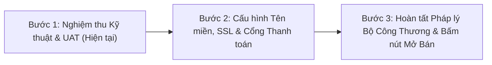

# DANH SÁCH KIỂM TRA ĐIỀU KIỆN MỞ BÁN CHÍNH THỨC (GO-LIVE CHECKLIST)
## BBKCOMMERCE E-COMMERCE PLATFORM

Bảng kiểm tra này được thiết kế theo tiêu chuẩn công nghiệp thương mại điện tử nhằm đảm bảo không có bất kỳ rủi ro kỹ thuật, pháp lý hoặc vận hành nào xảy ra trong ngày khai trương mở bán chính thức.

---

## 1. BẢNG KIỂM TRA THEO TỪNG HẠNG MỤC

### 1. KỸ THUẬT VÀ HẠ TẦNG (INFRASTRUCTURE & TECHNICAL)

- [ ] **1.1. Tên miền chính thức:** Trỏ bản ghi DNS `A` của tên miền doanh nghiệp (vd: `ajcommerce.vn`) về địa chỉ IP AWS EC2 `54.255.194.4`.
- [ ] **1.2. Chứng chỉ SSL/HTTPS:** Kích hoạt Let's Encrypt SSL miễn phí hoặc chứng chỉ trả phí (Comodo/DigiCert), thiết lập tự động gia hạn (Auto-renew) và chuyển hướng 100% từ HTTP sang HTTPS (301 Redirect).
- [ ] **1.3. Nginx Security Headers:** Thêm `X-Frame-Options: DENY`, `X-Content-Type-Options: nosniff`, `HSTS` vào Nginx.
- [x] **1.4. Bộ nhớ Swap chống tràn RAM:** Đã kích hoạt 2GB Swap Memory trên EC2.
- [x] **1.5. Khởi động cùng hệ thống:** PM2 đã lưu cấu hình `pm2 save` và đăng ký service `systemd` tự chạy khi reboot.
- [x] **1.6. CI/CD Pipeline:** GitHub Actions tự động kiểm thử và deploy mượt mà mỗi khi push code lên nhánh `main`.
- [x] **1.7. Database Connection:** Kết nối an toàn TLS `sslaccept=strict` tới cụm TiDB Cloud Serverless Singapore.

---

### 2. DỮ LIỆU & QUẢN TRỊ KHO HÀNG (CATALOG & INVENTORY)

- [x] **2.1. Danh mục sản phẩm:** 6 danh mục lớn đã được phân loại chuẩn mực.
- [x] **2.2. Số lượng sản phẩm:** 233 sản phẩm công nghệ đã nạp đầy đủ thông tin, thông số kỹ thuật và hình ảnh sắc nét.
- [ ] **2.3. Rà soát giá bán thực tế:** Đối chiếu lại giá niêm yết và giá khuyến mãi của 233 sản phẩm so với giá nhập kho và thị trường thực tế trước ngày mở bán.
- [ ] **2.4. Cập nhật số lượng tồn kho thực:** Điều chỉnh trường `stock` của các sản phẩm theo số lượng hàng hóa thực tế đang lưu tại kho của doanh nghiệp.
- [x] **2.5. Công cụ chỉnh sửa sản phẩm:** Trang `/admin/products/[id]/edit` hoạt động tốt, cho phép cập nhật giá và tồn kho tức thì.
- [x] **2.6. Video Banner quảng bá:** Đã cấu hình Video Banner Full HD 1080p và hỗ trợ phát video YouTube mượt mà.

---

### 3. THANH TOÁN & VẬN ĐƠN (PAYMENTS & FULFILLMENT)

- [x] **3.1. Phương thức Thanh toán khi nhận hàng (COD):** Hoạt động trơn tru từ giỏ hàng đến tạo đơn hàng.
- [x] **3.2. Phương thức Chuyển khoản ngân hàng:** Hiển thị thông tin số tài khoản và mã QR chuyển khoản chính xác.
- [ ] **3.3. Cổng thanh toán trực tuyến (VNPay / MoMo):** Đăng ký tài khoản Merchant doanh nghiệp, lấy thông tin `TMN_CODE` & `HASH_SECRET` điền vào `.env` production để kích hoạt thanh toán thẻ / ví điện tử.
- [ ] **3.4. Thỏa thuận với đối tác vận chuyển:** Ký hợp đồng dịch vụ giao hàng thu hộ COD với GHTK, Viettel Post hoặc VNPost; thống nhất bảng phí ship theo vùng miền.

---

### 4. TRẢI NGHIỆM KHÁCH HÀNG & HỖ TRỢ (CUSTOMER CARE)

- [x] **4.1. Quy trình mua hàng không lỗi:** Kiểm thử luồng: Chọn sản phẩm -> Thêm giỏ hàng -> Áp mã voucher -> Nhập địa chỉ -> Đặt hàng -> Xem chi tiết đơn hàng hoạt động 100%.
- [x] **4.2. Trang chi tiết sản phẩm:** Đã khắc phục triệt để lỗi "This page couldn't load", hiển thị đầy đủ thông số kỹ thuật và ảnh sản phẩm.
- [x] **4.3. Quản lý tài khoản:** Khách hàng có thể tự cập nhật số điện thoại, quản lý nhiều địa chỉ nhận hàng và đổi mật khẩu an toàn.
- [ ] **4.4. Dịch vụ gửi Email tự động:** Cài đặt dịch vụ Resend hoặc Amazon SES để tự động gửi email hóa đơn đơn hàng và email khôi phục mật khẩu.
- [ ] **4.5. Kênh hỗ trợ trực tuyến:** Cài đặt widget chat Zalo OA hoặc Facebook Fanpage ở góc màn hình để tư vấn khách hàng 24/7.

---

### 5. PHÁP LÝ & QUY ĐỊNH THƯƠNG MẠI ĐIỆN TỬ VIỆT NAM (LEGAL COMPLIANCE)

- [ ] **5.1. Thông báo website TMĐT bán hàng:** Đăng ký tài khoản trên Cổng thông tin Quản lý hoạt động Thương mại điện tử của Bộ Công Thương ([online.gov.vn](http://online.gov.vn)), khai báo thông tin website và gắn logo *"Đã Thông Báo Bộ Công Thương"* có liên kết xác thực.
- [ ] **5.2. Thông tin pháp lý tại Footer:**
  - Tên doanh nghiệp / Hộ kinh doanh sở hữu website.
  - Mã số doanh nghiệp (MST) / Ngày cấp / Nơi cấp.
  - Địa chỉ trụ sở chính và kho hàng thực tế.
  - Số điện thoại hotline và email liên hệ chính thức.
- [x] **5.3. Chính sách bán hàng công khai:** Đã có các trang chính sách về giao hàng, bảo hành chính hãng 12 tháng, đổi trả 30 ngày và bảo mật thông tin cá nhân khách hàng.

---

## 2. LỘ TRÌNH THỰC HIỆN GO-LIVE 3 BƯỚC

1. **Bước 1 (Hoàn thành ngay):** Nghiệm thu toàn bộ tính năng giao diện, hệ thống quản trị, giỏ hàng và danh mục 233 sản phẩm trên AWS EC2.
2. **Bước 2 (1 - 3 ngày):** Mua tên miền, cấu hình SSL Let's Encrypt (miễn phí), cài đặt email gửi hóa đơn và đăng ký tài khoản thanh toán VNPay/MoMo.
3. **Bước 3 (1 - 2 tuần):** Nộp hồ sơ thông báo website với Bộ Công Thương (thủ tục online miễn phí), đồng bộ tồn kho thực tế và chính thức chạy chiến dịch truyền thông ra mắt.

